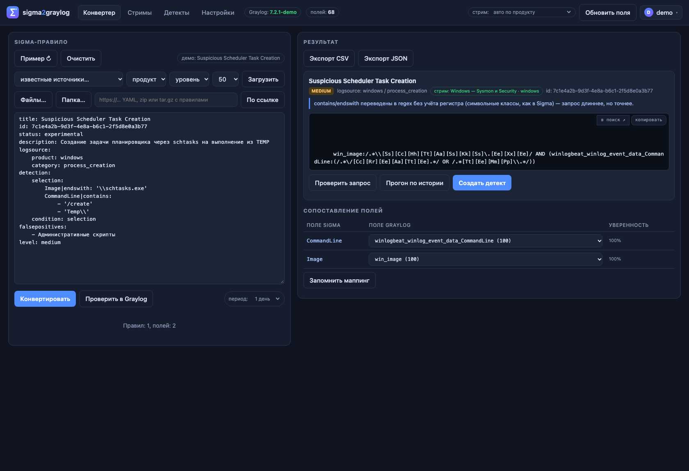
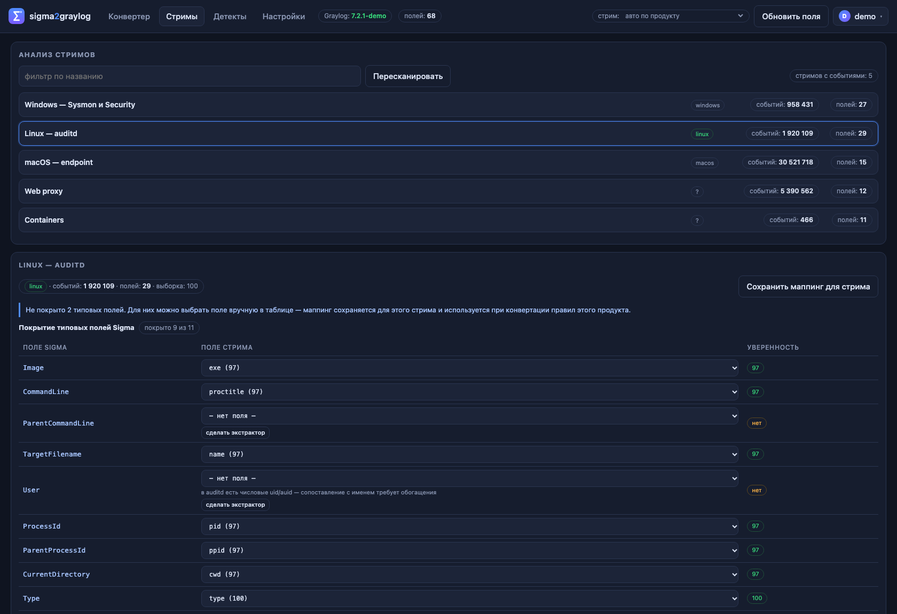

<p align="center">
  
</p>

<h1 align="center">sigma2graylog</h1>

[](https://github.com/ArsIS-02/sigma2graylog/actions/workflows/ci.yml)
[](LICENSE)
[](https://www.python.org/)
[](https://graylog.org/)

**Convert Sigma rules into Graylog detections — matched against the fields that actually exist in your indices.**

Sigma rules are written in terms of Windows event fields (`Image`, `CommandLine`, `EventID`),
while Graylog stores them as `winlogbeat_winlog_event_data_Image`, `exe`, `proctitle`, `name` and so on.
Pasting a Sigma query into Graylog usually produces a query that silently matches nothing.
This tool closes that gap: it parses the rule with [pySigma](https://github.com/SigmaHQ/pySigma),
picks the stream belonging to the rule's product, maps every field onto the real field list of that
stream, rewrites the query into syntax Graylog accepts, and shows how noisy the rule is on your own
historical data — before you create a detection.



## Features

| | |
|---|---|
| **Conversion** | Sigma YAML to Graylog Lucene query, single rule or batches |
| **Field mapping** | per-stream field lists, product routing, semantic dictionary, manual overrides |
| **Stream analysis** | which Sigma fields a stream covers, which are missing, and what to do about it |
| **History run** | per-day hit counts for the last 30 days, "noisy / quiet" verdict, sample events |
| **Duplicate check** | compares a new query with existing event definitions (query tokens + title) |
| **Detections tab** | browse, search, open and delete existing Graylog event definitions |
| **Batch mode** | table with filters, bulk creation with a dry-run preview and per-item report |
| **Rule sources** | built-in catalog of public Sigma sets (SigmaHQ, ThreatHunting Keywords, ...) |
| **Extractor generator** | emits a Graylog pipeline rule for a field missing in your stream |
| **Settings UI** | Graylog URL, token or password, cache TTL, defaults — secrets encrypted at rest |



## Quick start (demo, no Graylog needed)

```bash
git clone https://github.com/ArsIS-02/sigma2graylog.git
cd sigma2graylog
docker compose -f docker-compose.demo.yml up --build
# or: podman-compose -f docker-compose.demo.yml up --build
```

Open http://localhost:8080 — the app runs on synthetic data, no login required.

## Quick start (real Graylog)

```bash
cp .env.example .env
# edit GRAYLOG_URL, GRAYLOG_USER, GRAYLOG_PASSWORD, APP_PASSWORD
podman build -t sigma2graylog .
podman run -d --name sigma2graylog --restart unless-stopped \
  --security-opt label=disable \
  -p 8080:8080 --env-file .env -v /srv/sigma2graylog:/data sigma2graylog
```

Open http://localhost:8080, log in with `APP_USER` / `APP_PASSWORD`, then fill in the connection
details under Settings — the UI validates them with a live request to `/api/system`.

> On SELinux systems run with `--security-opt label=disable` and mount the data directory without
> `:Z`. With `:Z` podman assigns new MCS categories on every container re-creation, previously
> written files become unreadable, and the app re-creates `users.json` on start, silently resetting
> the password.

## Configuration

| Variable | Purpose |
|---|---|
| `GRAYLOG_URL` | Graylog base URL, e.g. `http://graylog.example.com:9000` |
| `GRAYLOG_PUBLIC_URL` | URL used in generated links (must resolve from your workstation) |
| `GRAYLOG_USER` / `GRAYLOG_PASSWORD` | service account |
| `GRAYLOG_TOKEN` | alternative to user/password |
| `APP_USER` / `APP_PASSWORD` | UI credentials, used **only** to create the first user |
| `FIELDS_TTL` | field-list cache, seconds (default 600) |
| `DEMO_MODE` | `1` — synthetic data, no external Graylog |

Values from the Settings tab override environment variables; they are stored in
`/data/settings.json` with `0600`, secrets encrypted (Fernet, key derived from `/data/secret.key`).

## How the mapping works

1. **Every stream gets a product** — inferred from the fields its events actually contain:
   `winlogbeat_*` -> windows, `audit_type` / `proctitle` -> linux, `macos_*` -> macos.
   Based on a sample of recent events, cached for 10 minutes.
2. **The rule's product selects the stream**, and the mapping universe becomes that stream's real
   fields instead of a global list. A `product: linux` rule can never be mapped onto `winlogbeat_*`.
3. **Semantic dictionary** covers the usual suspects: in auditd `CommandLine` is `proctitle`,
   `Image` is `exe`, `TargetFilename` is `name`; in Windows `Image` is `win_image` or
   `winlogbeat_winlog_event_data_Image`, whichever is more common in the sample.
4. **Confidence scoring** ranks candidates; anything below 70 is reported as "field not found" with
   suggestions instead of being silently substituted.

## Graylog quirks this tool works around

Verified against Graylog 7.2.1:

- `field:*value*` — **parse error** (leading wildcard without quotes);
- `field:"*value*"` — parses, but matches nothing;
- `field:/.*value.*/` — works; this is what `contains` / `endswith` compile to;
- regex in Graylog is **case-sensitive**, Sigma is not — enabled by default, letters are expanded
  into character classes (`[Pp]ower[Ss]hell`);
- `POST /api/events/definitions` needs the body wrapped in `{"entity": {...}}` with an empty
  `series` array;
- `DELETE` requires the `X-Requested-By` header.

## API

| Method | Path | |
|---|---|---|
| POST | `/api/convert` | `{sigma, overrides?, probe?, stream_id?}` -> queries, mapping, warnings |
| POST | `/api/history` | `{query, days, stream_id?}` -> per-day buckets, verdict, samples |
| POST | `/api/event-definition` | create one detection (requires `confirm: true`) |
| POST | `/api/event-definitions/bulk` | batch create with dry-run and duplicate skipping |
| GET | `/api/detections` | existing definitions, filters `all`, `never`, `matched` |
| GET | `/api/streams?profiles=true` | streams with detected product and field count |
| GET | `/api/streams/{id}/analysis` | Sigma coverage for a stream |
| POST | `/api/streams/{id}/overrides` | persist manual mapping for a stream |
| POST | `/api/sources/{id}/fetch` | download a public rule set, filter, return rules |
| GET/PUT | `/api/settings` | connection settings (secrets never returned) |

## Limitations

- Regex is case-insensitive only through character classes, which makes long queries ~4x longer;
  expansion is skipped above 48 characters.
- A stream's field list comes from a sample of 100 events, so rare fields may be missed.
- Detections are created with `alert: false` and without notifications — wire those in Graylog.
- Field extraction is not performed: if a value exists only inside `message`, generate an extractor
  and apply it as a pipeline rule first.

## License

MIT — see [LICENSE](LICENSE). Third-party components are listed in [THIRD-PARTY.md](THIRD-PARTY.md);
pySigma and pySigma-backend-elasticsearch are LGPL and are installed as dependencies, not vendored.

Russian documentation: [README.md](README.md).
